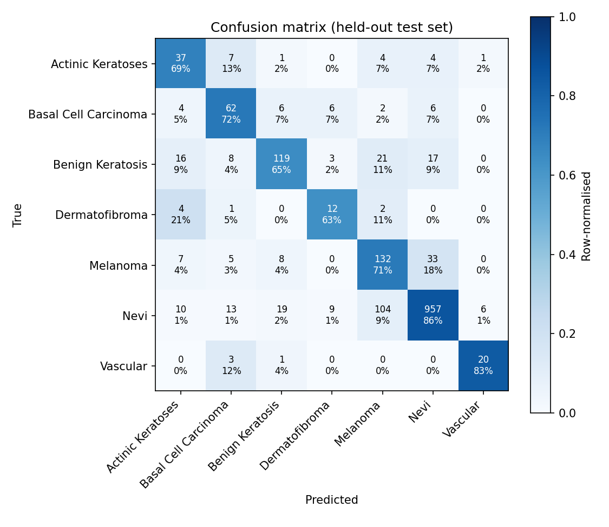

# SkinSense evaluation (held-out test split)

- Date: 2026-11-04T13:06:20
- Weights: `runs/finetune/skin_sense_ensemble_final.pth`
- Lesion-grouped split: **True**
- Test images: 1670

| Metric | Uncalibrated | Temperature-scaled |
|---|---|---|
| accuracy | 0.8018 | 0.8018 |
| balanced_accuracy | 0.7268 | 0.7268 |
| macro_f1 | 0.6703 | 0.6703 |
| macro_auc_ovr | 0.9555 | 0.9555 |
| ece | 0.0693 | 0.0259 |
| nll | 0.5528 | 0.5238 |

Temperature T = 0.688

## Per class (temperature-scaled)

| Class | Precision | Recall | F1 | AUC | Support |
|---|---|---|---|---|---|
| Actinic Keratoses | 0.474 | 0.685 | 0.561 | 0.976 | 54 |
| Basal Cell Carcinoma | 0.626 | 0.721 | 0.670 | 0.979 | 86 |
| Benign Keratosis | 0.773 | 0.647 | 0.704 | 0.944 | 184 |
| Dermatofibroma | 0.400 | 0.632 | 0.490 | 0.916 | 19 |
| Melanoma | 0.498 | 0.714 | 0.587 | 0.921 | 185 |
| Nevi | 0.941 | 0.856 | 0.896 | 0.961 | 1118 |
| Vascular | 0.741 | 0.833 | 0.784 | 0.992 | 24 |

## Melanoma escalation rule

Flag when P(melanoma) >= **0.1027** (chosen on validation for 90% sensitivity).

- Validation: sensitivity 0.903, specificity 0.734
- **Test**: sensitivity 0.908, specificity 0.729 (185 melanomas, 1485 others)

